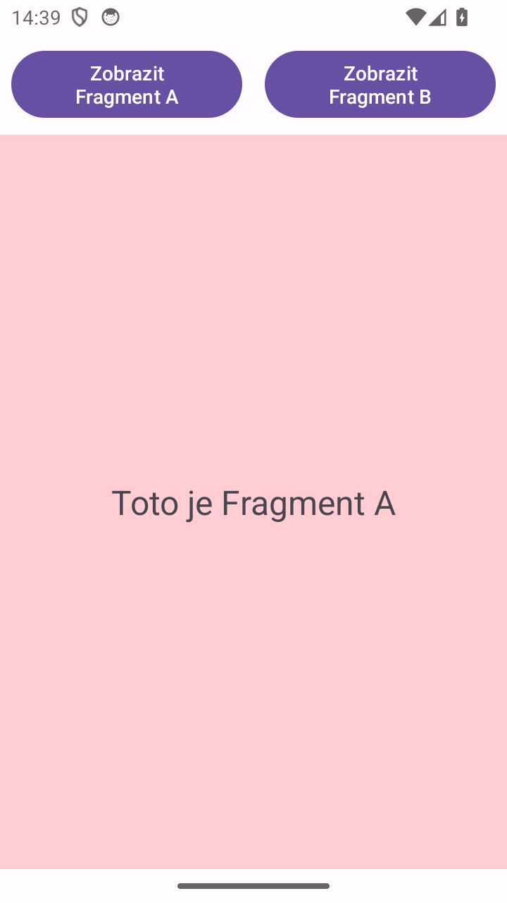
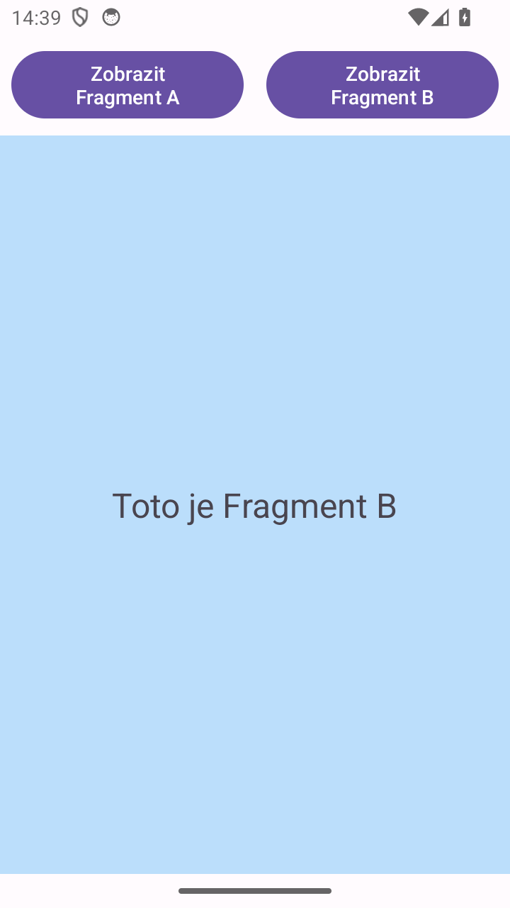

# Fragmenty

Jedna aktivita se dvěma tlačítky. Každé tlačítko zobrazí v kontejneru `FragmentContainerView` jiný prázdný fragment (`FragmentA`, `FragmentB`).

 

Přepnutí dělá `supportFragmentManager.beginTransaction().replace(...).commit()` v `MainActivity`.
