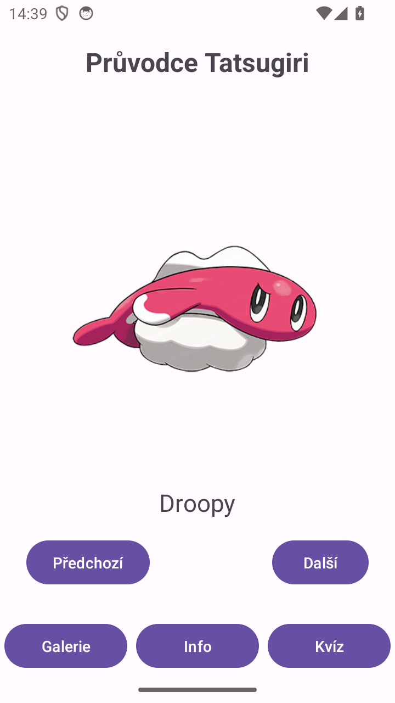
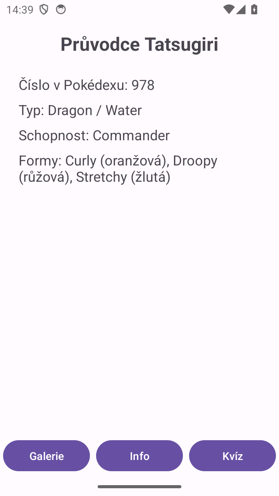
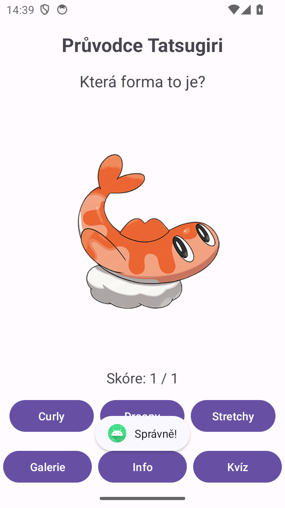

# Průvodce Tatsugiri

Aplikace se třemi fragmenty, mezi kterými se přepíná tlačítky dole:

- **Galerie** (`GalleryFragment`): obrázek a název formy, tlačítka Předchozí a Další
- **Info** (`InfoFragment`): základní údaje o Pokémonovi
- **Kvíz** (`QuizFragment`): ukáže náhodnou formu, uživatel hádá, která to je, výsledek oznámí Toast a počítá se skóre

  

Fragmenty s ovládáním používají View Binding. Texty jsou anglicky a česky.
