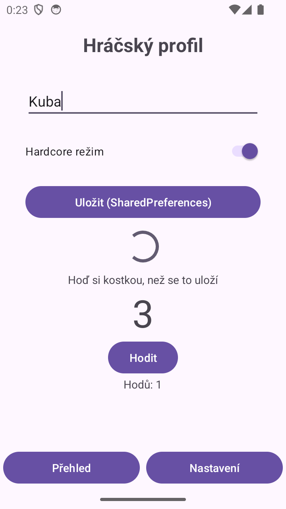
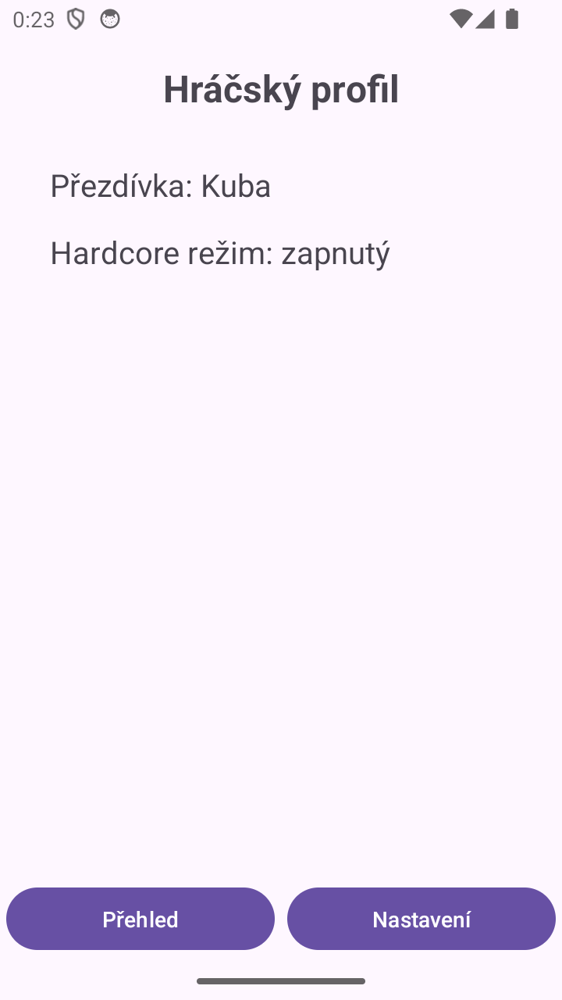

# Hráčský profil (SharedPreferences)

Aplikace se dvěma fragmenty, mezi kterými se přepíná tlačítky dole:

- **Přehled** (`DashboardFragment`): vypíše uloženou přezdívku a jestli je zapnutý hardcore režim
- **Nastavení** (`SettingsFragment`): pole pro přezdívku, přepínač, kolečko, které se pořád točí, a tlačítko Uložit

Uložit čeká 3 s přes `Thread.sleep(3000)` a pak zapíše data synchronně přes SharedPreferences (`commit()`). Výsledek oznámí Toast. Během čekání se celá aplikace zasekne, kolečko se přestane točit.

Navíc je v nastavení kostka, která s ukládáním nesouvisí. Když se na ni klikne během ukládání, hodí se až po 3 s, protože hlavní vlákno je zablokované.

 
