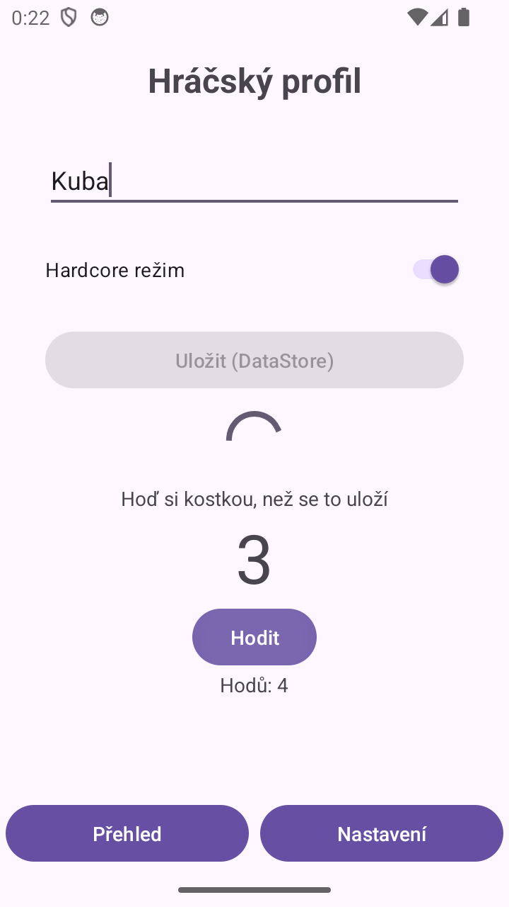
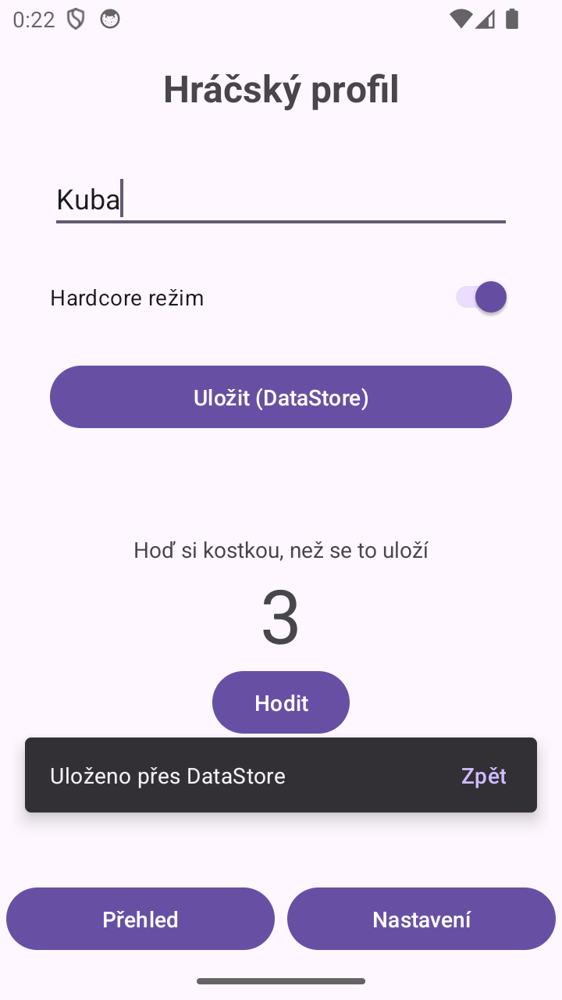

# Hráčský profil (DataStore)

Stejné rozhraní jako [MyApp008aSharedPref](../MyApp008aSharedPref), jen ukládání je přes DataStore:

- ukládá se v `lifecycleScope.launch`, místo `Thread.sleep` je `delay(3000)`, takže hlavní vlákno zůstává volné
- kolečko je vidět jen při ukládání a točí se plynule, tlačítko Uložit je zatím vypnuté
- výsledek oznámí Snackbar s tlačítkem Zpět, které vrátí předchozí přezdívku a režim
- přehled načítá data z DataStore taky asynchronně

Kostka v nastavení jde ovládat i během ukládání a reaguje hned.

 
