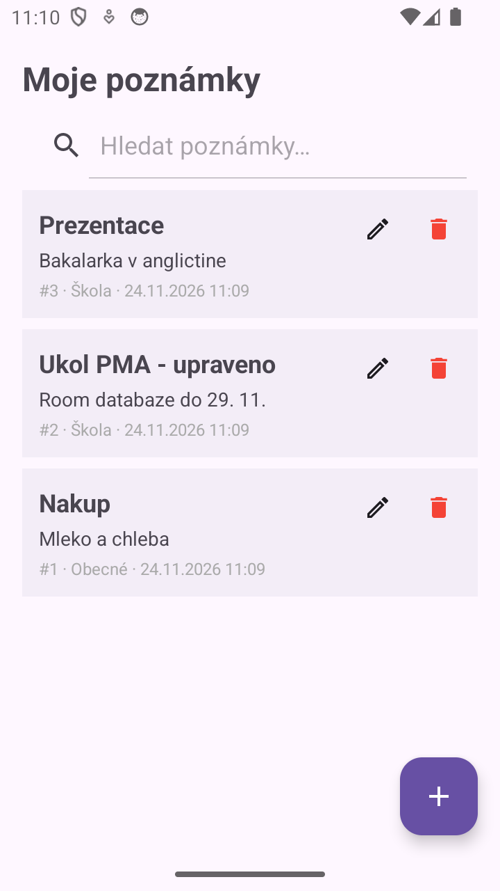
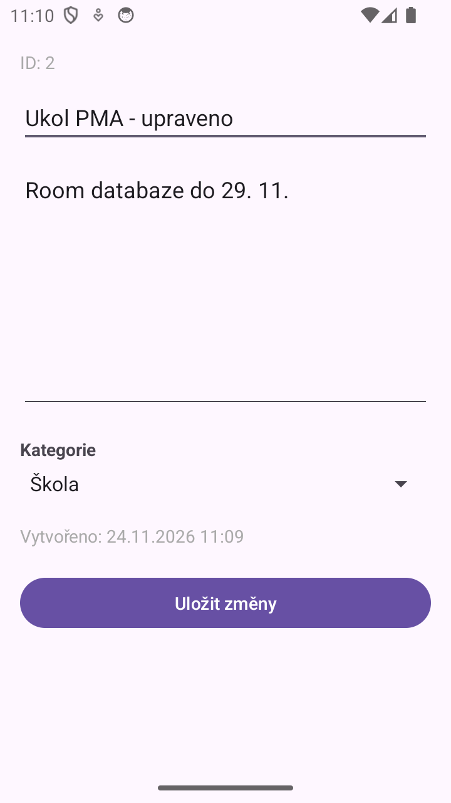
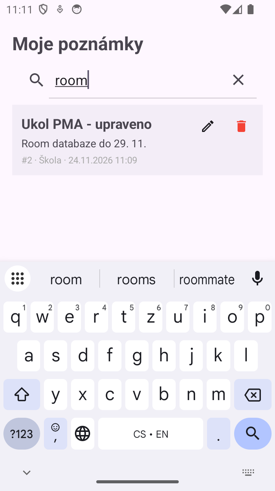
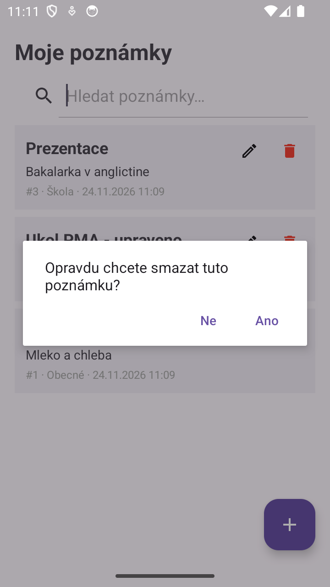

# MyNoteHub (Room DB)

Jednoduchý poznámkovník, který ukládá poznámky do databáze Room (Room 3, KSP).

- **Seznam poznámek** (`MainActivity`): RecyclerView, data z databáze přes Flow, seznam se sám obnoví po každé změně
- **Přidání** (`AddNoteActivity`): název, obsah a kategorie ze spinneru, datum vytvoření se uloží samo
- **Editace** (`EditNoteActivity`): ikona tužky otevře poznámku podle ID, zobrazí ID a datum vytvoření
- **Mazání**: ikona koše, před smazáním se zeptá dialogem
- **Hledání**: SearchView nad seznamem hledá v názvu i v obsahu

Databáze je ve verzi 2, migrace z verze 1 přidává sloupce `createdAt` a `category`. Aplikace je v angličtině a češtině.

   
